# Laptop Alarm: technical documentation

How Laptop Alarm works, from the menu bar click to the siren. This is for people who want to read, change or port the code. For installing and using it, read the [README](../README.md).

**Status.** Built and tested on one machine (MacBook Air M5, macOS 26.7.1). Where a claim has not been run end to end, this document says so. The line numbers and names refer to the code at the commit that added this file.

## Contents

1. [Overview](#1-overview)
2. [Source layout](#2-source-layout)
3. [Privilege model](#3-privilege-model)
4. [Arming: from click to armed](#4-arming-from-click-to-armed)
5. [Sensing and triggers](#5-sensing-and-triggers)
6. [The alarm output](#6-the-alarm-output)
7. [Phone push](#7-phone-push)
8. [States](#8-states)
9. [The control protocol](#9-the-control-protocol)
10. [Disarming, signals and cleanup](#10-disarming-signals-and-cleanup)
11. [The menu bar app](#11-the-menu-bar-app)
12. [Build and packaging](#12-build-and-packaging)
13. [Tests](#13-tests)
14. [Failure modes](#14-failure-modes)
15. [Known gaps](#15-known-gaps)
16. [Design decisions](#16-design-decisions)

## 1. Overview

Laptop Alarm is two programs that share some code.

- The **alarm engine** (`laptop-alarm`) is a command line program that runs as root. It reads the motion and lid sensors, decides when something has happened, plays the siren and the spoken warning, keeps the Mac awake, and sends the phone push.
- The **menu bar app** (`LaptopAlarm.app`) runs as you. It shows the lock icon and the menu, starts the engine through the macOS administrator prompt, and talks to it over a private Unix socket.



The engine needs root for two things: waking the accelerometer, and `pmset -a disablesleep`. Everything else could run as a normal user. That is the reason there are two programs, and it shapes most of the design: the root part is kept as small and as hard to misuse as practical, and the app never gets root itself.

The engine also works on its own from a terminal (`sudo ./build/laptop-alarm arm`), which is how it was developed and how it is still debugged. The app launches the same binary with `--headless`.

## 2. Source layout

```
Sources/
  Shared/     code used by the engine, the app and the tests
  AppLogic/   the app's pure logic, with no AppKit, so it can be unit tested
  Engine/     the root engine and its command line
  App/        the AppKit menu bar app
tests/        plain test runner and bundle check
tools/        icon generator, sensor probe
build.sh      build, test, bundle and install
```

| File | What it does |
|---|---|
| `Shared/Protocol.swift` | The control protocol: states, messages, commands, encode and decode. The socket path. |
| `Shared/LineSocket.swift` | A line-based Unix socket server and client. Creates the socket with the right ownership and permissions. |
| `Shared/ControlLogic.swift` | What the engine does with each command, as a pure function. |
| `Shared/AttemptLimiter.swift` | Backoff for wrong passwords. |
| `Shared/Push.swift` | The ntfy topic file and the `curl` call. |
| `Shared/VoiceFile.swift` | Reads a WAV safely and renders speech with `say`. |
| `Shared/InvokingUser.swift` | Works out which human account is behind a root process. |
| `Shared/Process.swift` | A small `run(path, args)` helper. |
| `AppLogic/AppState.swift` | The app's state machine and what the menu shows in each state. |
| `AppLogic/Settings.swift` | The Sensitivity and Siren volume presets. |
| `AppLogic/Elevation.swift` | Builds the `osascript` command and reads its result. |
| `AppLogic/AppHelpers.swift` | Warning de-duplication, status text wrapping, engine lookup. |
| `Engine/main.swift` | Sensors, triggers, siren, cleanup, signals, the `Alarm` class and the command line. |
| `Engine/ControlServer.swift` | Serves the socket inside the engine. |
| `Engine/ControlClient.swift` | The engine binary's own `status` and `disarm` commands. |
| `App/StatusItemController.swift` | The menu bar item, the menu, and the arm, cancel and disarm flows. |
| `App/EngineLauncher.swift` | Runs `osascript` off the main thread. |
| `App/DisarmPrompt.swift` | The password dialog. |
| `App/PhoneAlertsWindow.swift` | Creating and testing the phone alert topic. |

## 3. Privilege model

### Who runs as whom

| Piece | Runs as | Why |
|---|---|---|
| Menu bar app | you | It is a normal app. It never holds root. |
| `osascript` | you, then asks macOS for administrator rights | This is the standard password prompt. |
| Engine | root | Needed to wake the accelerometer and to disable sleep. |
| `say` voice rendering | you (in the app) | `say` is silent under the admin-prompt launch, even via `sudo -u`. |

### How root is obtained

The app runs `/usr/bin/osascript` with `do shell script "<command>" with administrator privileges`. macOS shows its own password dialog. The command is the engine path and its arguments, redirected to `/dev/null` and backgrounded so `osascript` returns. The app never sees the password. There is no stored credential and no installed helper, so **you are asked every time you arm**.

Because the command runs as root, it is built with care (`AppLogic/Elevation.swift`):

1. Every word, including the engine path, is quoted for the shell with POSIX single quotes.
2. The whole command is then escaped for an AppleScript string (backslash first, then the double quote).
3. A test runs 19 hostile strings (spaces, quotes, `$()`, backticks, newlines, backslashes) through a real shell and a real `osascript` literal and compares the results byte for byte.

### What can reach the root engine

The engine accepts three kinds of input from outside:

- **The control socket**, which only your account can open (section 9).
- **Command line arguments**, which come from the app. The user name is checked, and `root` is rejected.
- **A voice file path**, from `--voice-file`. The engine opens it with `O_NOFOLLOW`, requires a regular file, and refuses anything over 10 MB, so a FIFO or `/dev/zero` cannot hang it.

### Accepted risks

- The engine runs from `LaptopAlarm.app/Contents/Resources/laptop-alarm`, a file your account owns. A process that already runs as you could replace it before your next arming and get root. Avoiding this needs a privileged helper installed with extra setup, which was ruled out. It is listed in the README's limitations.
- Any process running as you can talk to the socket. It can cancel during the countdown, and it can try passwords, rate limited as described in section 9.

## 4. Arming: from click to armed



### In the app

When you choose **Arm** (`StatusItemController.arm`):

1. Any old client connection is closed first, so its events cannot move the app out of the launching state.
2. The state moves to `launching`.
3. On a background queue the app renders the spoken warning with `say` into a private directory, `laptop-alarm-voice-<uuid>` under the temp folder, mode 0700. If rendering fails it carries on without a voice file.
4. It builds the arguments: `arm --headless --user <you> --countdown 10 --tilt <T> --shock <G> --volume <V>` and, when the voice rendered, `--voice-file <path>`.
5. `EngineLauncher` runs `osascript` off the main thread. A cancelled dialog returns to `disarmed` with no error.
6. On success it tries to connect to the socket every 0.25 seconds for up to 10 seconds. If nothing answers, the state becomes `failed("The alarm engine did not start.")`.

### In the engine

`Alarm.start()` does things in this order, and the order matters:

1. **Terminal mode only:** it refuses to start without a terminal (`/dev/tty`), because the password prompt needs one. Headless mode skips this.
2. **Headless: start the control server before anything else.** If another engine already owns the socket, this one exits with "An alarm is already running." It must not run its cleanup, because that would undo the first engine's sensor, volume and sleep state. Any other socket error is fatal too. After a successful start the published state is `countdown(N)`. The engine never publishes `disarmed` while starting up.
3. Install signal handlers.
4. **Wake the sensors** (section 5), start the accelerometer, open the lid sensor. If either is missing it raises a warning rather than stopping.
5. **Prepare the sound** (section 6). This blocks the main queue until the voice file is read, so no client is greeted before that. The app relies on this when it deletes the voice directory after its first state message.
6. Save the current volume and whether sleep was already disabled.
7. Start a 0.1 second ticker, then the countdown.
8. When the countdown ends, the state becomes `calibrating` for one second. `finishArming` then runs.

### Calibration

During the one second of calibration the engine collects the filtered accelerometer samples. At 50 Hz that is about 50.

- **10 or more samples:** the average is the baseline gravity vector.
- **Fewer than 10:** there is no baseline, the motion trigger is off, and the engine arms in the **degraded** state.

`finishArming` also records the resting lid angle and whether the charger was connected, then runs `pmset -a disablesleep 1`, sets the state to armed, and publishes `armed` (or `degraded`).

## 5. Sensing and triggers

### The sensors

All of these are HID devices on Apple's SPU transport, found by usage page and usage:

| Sensor | Usage page / usage | How it is read |
|---|---|---|
| Accelerometer | `0xFF00` / `0x0003` | Pushed input reports at 50 Hz. Needs waking (below). |
| Lid angle | `0x0020` / `0x008A` | Polled with a feature report, ID 1. Bytes 1 and 2 are the angle in degrees. |
| Lid closed | `IOPMrootDomain` | The `AppleClamshellState` property. |
| Charger | IOKit power sources | Whether the providing source is "AC Power". |

The accelerometer report is at least 18 bytes. Bytes 6 to 17 hold X, Y and Z as signed 32-bit little-endian integers, and 65536 equals 1 g. They are decoded as whole integers, never byte by byte, because noise around zero flips individual bytes between `0x00` and `0xFF`.

### Waking the accelerometer

The accelerometer stays silent until woken. The engine writes three properties to the `AppleSPUHIDDriver` services:

| Property | Value |
|---|---|
| `SensorPropertyReportingState` | 1 |
| `SensorPropertyPowerState` | 1 |
| `ReportInterval` | 20,000 microseconds (50 Hz) |

It first saves each property's old value and writes everything back on exit. If a value could not be read and only the accelerometer was touched, the accelerometer is put back to sleep. **These property names are undocumented and came from hobbyist reverse engineering.** They worked on the one Mac tested. `tools/sensor_probe_v2.swift` is the tool for checking another model.

### Filtering

Each sample goes through an exponential moving average, `f = f + 0.3 (v - f)`. The filter smooths single-sample spikes while keeping a real motion visible.

### The triggers

While armed, the engine checks these. The first one that fires wins.

| Trigger | Condition | Where |
|---|---|---|
| Motion, tilt | The angle between the filtered vector and the baseline is over `--tilt` (default 2 degrees). | Every sample |
| Motion, shock | The difference between the lengths of the filtered vector and the baseline is over `--shock` (default 0.09 g). | Every sample |
| Lid closed | `AppleClamshellState` is true. | 0.1 s ticker |
| Charger unplugged | It was on AC when armed, and now is not. Only if armed on AC. | 0.1 s ticker |
| Lid angle | The angle differs from the resting angle by more than `--lid` (default 3 degrees) on **2 consecutive** polls. | 0.1 s ticker |

For motion, tilt or shock must stay over its threshold for **5 consecutive samples** (100 ms) before it counts. That is what keeps a brief vibration from firing the alarm. The thresholds come from measurement on the one machine:

| Measured peak | Tilt | Shock |
|---|---|---|
| Idle | 0.2 degrees | 0.001 g |
| Table bump | 0.6 degrees | 0.066 g |
| Gentle lift | 7.3 degrees | 0.131 g |

If the accelerometer stops reporting for more than 2 seconds while armed, the engine moves to the **degraded** state and says so. The alarm stays armed on the other triggers.

## 6. The alarm output

### Building the sound

The engine builds one WAV file in memory when it starts, so firing never waits on anything:

1. A **siren**: a square wave at 90% amplitude whose pitch sweeps between 700 and 1600 Hz in a triangle shape, repeating every second, for 2 seconds.
2. 0.2 seconds of silence, then the **voice**, then 0.2 seconds of silence.

The voice is the spoken phrase "This laptop is being stolen", normalized so its peak is 90%. It comes from, in order:

1. **`--voice-file`**, rendered by the app as you. This is the normal path. `say` is silent under the admin-prompt launch, so the app does the rendering where it works.
2. **`say` run as the invoking user** from the engine. This is the terminal path, using `sudo -u <you> say` in a private temporary directory that your account owns.
3. **Nothing.** The siren plays alone and the engine logs a warning.

### Playing it

When a trigger fires, the engine publishes the state, sets the volume, starts an `AVAudioPlayer` that loops forever, and sends the push. While the alarm sounds, the 0.1 second ticker forces the volume to the configured level (`--volume`, default 1.0) and unmutes the output, using CoreAudio on whichever device is the default output at that moment. Muting the Mac or turning the volume down is undone within a tenth of a second.

Known limits of this: the sound goes to the default output, which can be a Bluetooth device, and with the lid closed the built-in speakers are inaudible (section 14).

## 7. Phone push

On a trigger the engine sends one message to [ntfy.sh](https://ntfy.sh):

- **Where:** `POST https://ntfy.sh/<topic>`, with `curl`.
- **What:** title "Laptop alarm triggered", urgent priority, and the reason as the body, for example `lid closed` or `motion (tilt 3.7°, shock 0.006g)`. No location.
- **How:** from a background thread, with up to 5 attempts 3 seconds apart, so a poor connection never delays the siren. Success means an HTTP 200.

The **topic** is the only secret. It is `laptop-alarm-` plus 24 random lowercase letters and digits, stored in `~/.laptop-alarm-ntfy-topic` (mode 0600). It is created either by the **Phone alerts** window in the app or by `push-setup` in the terminal. If no topic exists, the alarm still works and the menu shows a warning.

## 8. States

### The engine



The engine has an internal state (`starting`, `countingDown`, `calibrating`, `armed`, `triggered`, `exiting`) and a **published** state that clients see (`AlarmState`). They differ in two ways. Degraded is a flag on the armed state, not a state of its own, so `trigger()` still works from it. And `disarmed` is published only just before the engine exits.

Cancel, disarm and signals all end at `disarmed`:

- **Cancel** needs no password and works only during the countdown or calibration.
- **Disarm** needs your password and works only when armed, degraded or triggered.
- **SIGTERM and SIGHUP** from any state stop the siren, run cleanup and exit. SIGINT does the same before arming, and is ignored while armed or triggered.

### The app

The app keeps its own state (`AppState`) and a pure function `reduce(state, event)` moves it. `presentation(for:)` turns each state into the menu text, the icon, and which items are enabled.

| App state | Menu shows | Quit |
|---|---|---|
| `disarmed` | "Disarmed", Arm enabled | enabled |
| `failed(message)` | "Failed: message", orange, Arm enabled | enabled |
| `launching` | "Starting alarm engine" | disabled |
| `countdown(n)` | "Arming in n s", Cancel | disabled |
| `calibrating` | "Calibrating", Cancel | disabled |
| `armed` | "Armed", red, Disarm | disabled |
| `armedDegraded(why)` | "Armed, degraded: why", orange, Disarm | disabled |
| `triggered(why)` | "ALARM: why", red and flashing, Disarm | disabled |
| `lost` | "Lost contact with the engine", orange | enabled |

Two rules in the reducer are worth knowing:

- A closed connection while `armed`, `armedDegraded` or `triggered` becomes `lost`. A closed connection while `launching`, `countdown` or `calibrating` becomes `failed("The alarm engine stopped before arming.")`, because every clean exit sends `STATE disarmed` first.
- An engine state message is accepted in every state, including `lost` and `failed`, because it proves an engine is alive. That is how a relaunched app picks up a running alarm.

## 9. The control protocol

The app, and the engine's own `status` and `disarm` commands, talk to the engine over a Unix stream socket.

| Property | Value |
|---|---|
| Path | `/var/run/laptop-alarm.sock` |
| Created by | The headless engine, which is root |
| Owner and mode | Your account, 0600 |
| Format | One line per message |
| Maximum line | 64 KiB |

### Messages

| From | Line | Meaning |
|---|---|---|
| Client | `STATUS` | Ask for the current state. |
| Client | `CANCEL` | Cancel during the countdown or calibration. |
| Client | `DISARM <base64>` | Disarm. The payload is the password, UTF-8, base64 encoded. |
| Engine | `STATE disarmed`, `countdown N`, `calibrating`, `armed`, `degraded <why>`, `triggered <why>` | The current state. |
| Engine | `WARN <text>` | A warning, for example that phone alerts are not set up. |
| Engine | `OK` | The last command worked. |
| Engine | `ERR <code>` | `wrong-password`, `rate-limited`, `not-armed`, `not-cancellable`, `bad-command`. |

The password is base64 encoded so that spaces, quotes, newlines or non-ASCII characters cannot break the line format. It is decoded strictly (invalid UTF-8 is rejected, and a leading byte-order mark is kept), and a test checks that it arrives byte for byte.

### What the engine does with a command

`decideControl` (a pure function) maps a command, the current state and the limiter to one of three outcomes:

| Command | In these states | Result |
|---|---|---|
| `STATUS` | any | Reply with the state. |
| `CANCEL` | countdown, calibrating | Cancel. |
| `CANCEL` | anything else | `ERR not-cancellable`. |
| `DISARM` | armed, degraded, triggered | Check the password, unless blocked: then `ERR rate-limited`. |
| `DISARM` | anything else | `ERR not-armed`. |

On connect, a client is sent the current state and then any warnings the engine already raised. That is why the app de-duplicates warnings.

### Checking the password

The check uses OpenDirectory against the invoking user. It runs on a background queue so a slow lookup never blocks signals or the siren, and **one check runs at a time**. A second `DISARM` while one is in flight gets `ERR rate-limited`.

The limiter is **one per process**, not one per connection, so reconnecting never resets it. After the nth wrong password in a row the next attempt is blocked for `min(2^(n-1), 30)` seconds: 1, 2, 4, 8, 16, then 30. A correct password resets it.

### How the socket is made safe

`LineSocketServer.start` does these things in order:

1. It checks whether an engine is live by connecting to the path. If one answers, it throws `alreadyRunning`. Otherwise it removes the stale file.
2. It binds under `umask 0177`, so the file is never world-accessible, then sets mode 0600.
3. As root, it changes the owner to your account **before listening**. If that fails for any reason, it removes the socket and fails, so there is never a root-owned socket the app cannot use.
4. It sets `SO_NOSIGPIPE` on every connection, so a client that disconnects cannot kill the engine.

All callbacks are delivered on the main queue.

## 10. Disarming, signals and cleanup

### Disarm

1. The app asks for your password in a secure text field and sends `DISARM`.
2. The engine verifies it. If correct it replies `OK`, stops the siren, runs cleanup, publishes `STATE disarmed`, and exits about 0.2 seconds later so the last lines reach the app.
3. If wrong, it replies `ERR wrong-password` and the app asks again.

The password exists in the app only as a local string and a text field that is cleared after use. It is never logged, printed or stored.

### Cleanup

`cleanup()` runs once and restores, in this order:

1. Stops the ticker.
2. Restores the volume and mute state saved at startup.
3. Turns `disablesleep` back off, but only if the engine was the one that turned it on.
4. Stops the accelerometer.
5. Writes the saved sensor properties back.
6. Restores the terminal settings (terminal mode).

### Signals

| Signal | While armed or triggered | Otherwise |
|---|---|---|
| SIGINT (Ctrl+C) | Ignored | Cleanup and exit |
| SIGTERM, SIGHUP | Cleanup and exit | Cleanup and exit |
| SIGKILL, a crash | Nothing runs | Nothing runs |

After a kill or a crash, the recovery steps are in the README: `./build/laptop-alarm status`, `./build/laptop-alarm disarm`, `sudo pkill -TERM laptop-alarm`, then `sudo pmset -a disablesleep 0`.

## 11. The menu bar app

`StatusItemController` is the one class that owns the menu item, the state, the socket client and the settings.

- **Settings** are the two presets below, saved as JSON in `UserDefaults` under the key `settings`. They apply at the next arming.

  | Setting | Low | Normal or Medium | High or Full |
  |---|---|---|---|
  | Sensitivity (tilt, shock) | 5 degrees, 0.15 g | 2 degrees, 0.09 g | 1 degree, 0.06 g |
  | Siren volume | 25% | 50% | 100% |

  Sensitivity defaults to Normal and siren volume to Full.
- **Warnings** from the engine are shown under the status line, de-duplicated by text, and cleared when the state returns to `disarmed`.
- **Reconnecting.** At launch the app tries one connection, so an alarm that was already running is picked up. In the `lost` state it tries again once on entering that state and each time the menu opens.
- **Disarm** is blocked while a check is in flight, so a second click cannot produce a false "too many attempts" message.
- **The voice directory** is deleted when the first state message arrives from the engine, when launching fails, and at app start for any left over from earlier runs.
- **The menu** wraps long status text and keeps the `sudo pmset -a disablesleep 0` recovery command on its own line. A "Copy recovery command" item appears when contact is lost.

The icon is an SF Symbol (a lock, with variants for each state). The app icon is separate and is drawn by `tools/make-icon.swift`.

## 12. Build and packaging

Everything builds with `swiftc` from Apple's free command line tools. There is no Xcode project and no package manager.

| Command | What it does |
|---|---|
| `./build.sh engine` | Builds `build/laptop-alarm`. |
| `./build.sh app` | Builds `build/LaptopAlarm.app`. |
| `./build.sh install` | Builds the app and copies it to `/Applications`. `INSTALL_DIR` overrides the folder. |
| `./build.sh app-dev` | Builds only the bare app binary. |
| `./build.sh test` | Builds and runs the unit tests. |
| `./build.sh bundle-check` | Checks the built `.app`. |
| `./build.sh clean` | Removes `build/`. |

The bundle contains:

```
LaptopAlarm.app/Contents/
  Info.plist                 LSUIElement true (no Dock icon), minimum macOS 14.0,
                             identifier com.laptopalarm.LaptopAlarm, icon AppIcon
  MacOS/LaptopAlarm          the menu bar app
  Resources/laptop-alarm     the engine, found at runtime through Bundle.main.resourceURL
  Resources/AppIcon.icns     generated during the build
```

It is signed with an ad-hoc signature (`codesign --sign -`), which Apple Silicon requires of every program. There is no Developer ID and no notarization. An app built on your own Mac carries no download quarantine, so it opens without a warning; this was expected but not verified.

**The icon** is drawn by `tools/make-icon.swift` with CoreGraphics at all ten sizes macOS needs, and `iconutil` packs them. Below 65 pixels the siren rays are dropped so the icon stays readable.

## 13. Tests

`./build.sh test` compiles `Sources/Shared`, `Sources/AppLogic` and `tests/` into one runner. It has no external dependencies.

| Tested | What |
|---|---|
| Protocol | Every state round trips. A tricky password arrives byte for byte. Garbage decodes to nothing. |
| Socket | File mode is 0600. A stale file is replaced. A second live server is refused. A client sees the server stop. |
| Limiter | The backoff and its 30 second cap. |
| Control logic | Every command in every state. |
| App state | Every transition and the full menu presentation, including the quit rule. |
| Elevation | Quoting against hostile input, run through a real shell and a real `osascript` literal. |
| Voice file | Parsing a WAV with a filler chunk. Refusing a FIFO, a symlink and an oversized file. |
| Settings | The presets and the exact engine arguments they produce. |
| Push | The topic format and the file mode. |

`tests/bundle-check.sh` verifies the built bundle: both binaries, the plist keys, the icon and the signature.

**Not tested automatically:** the sensors, the audio, the root paths (ownership of the socket, the password check, the admin prompt), the AppKit menu, and the engine's startup order. Those were checked by hand on one Mac, and the end-to-end run of the finished app is the owner's remaining checklist.

## 14. Failure modes

| What happens | What the user sees | Why |
|---|---|---|
| Admin dialog cancelled | Back to "Disarmed", no error | `osascript` exits with its cancel code. |
| Engine does not start | "Failed: The alarm engine did not start." after 10 s | The socket never appeared. |
| Engine dies before arming | "Failed: The alarm engine stopped before arming." | The connection closed without `STATE disarmed`. |
| Motion sensor not working | Orange "Armed, degraded", other triggers still active | No baseline, or the data stopped. |
| Connection lost while armed | "Lost contact with the engine" and the recovery command | The engine may still be running and sleep may still be disabled. |
| Wrong password | "Wrong password", asked again | Then slower after each repeat. |
| Phone alerts not set up | A warning line, alarm still works | No topic file. |
| Another engine already running | The second one exits, the first is untouched | The socket is already live. |
| Lid closed | The siren plays but cannot be heard | The built-in speakers are inaudible with the lid closed. Observed, accepted. The push is the answer for this case. |
| Bluetooth audio connected | The siren may go to the headphones | It plays on the default output. |
| Power button held down | Nothing | No software alarm survives a hard power-off. |
| Engine killed with `kill -9` | Sleep stays disabled until you recover | Cleanup is skipped. Use the recovery commands. |

## 15. Known gaps

These are known and were left on purpose, so you can decide whether they matter to you.

- **Starting two engines within microseconds** can let both pass the live-engine check. It needs two admin approvals at nearly the same instant. A lock file would close it.
- **A terminal-mode `sudo ./build/laptop-alarm arm`** has no single-instance guard, so it can run alongside an app-launched engine and the two would fight over sleep and sensor state.
- **The ntfy topic is passed to `curl` on its command line**, where it is visible in the process list for a moment. Passing it on standard input would fix that.
- **The topic file is created and then set to mode 0600**, which leaves a window of milliseconds with default permissions.
- **There is no timeout on the password check or on `say`.** A hung OpenDirectory lookup would leave `DISARM` returning "rate limited", and a hung `say` would leave the app in "Starting alarm engine". `sudo pkill -TERM laptop-alarm` recovers the first. The second needs a Force Quit of the app, because Quit is disabled while it is starting.
- **Failures before the socket exists are not logged anywhere you can read.** The engine's output goes to `/dev/null` when launched by the app, so an early failure shows only as the 10 second timeout.
- **A failed voice file is not reported to the app.** It goes to the engine's log only, so the menu does not say the spoken warning is missing.
- **Settings changed while armed apply only at the next arming**, without saying so.
- **Untested end to end:** quitting and reopening the app while armed, `kill -9` of the engine while armed, and the lid angle, charger and shock-only triggers one by one.

## 16. Design decisions

**Why a separate root engine, not a root app.** An app that runs as root has a far larger attack surface than a small command line program. Keeping the root part small, headless and driven only by a protected socket limits what can go wrong.

**Why the administrator prompt every time, and no helper.** An installed privileged helper would avoid the prompt, but it needs code signing, an installer and a trust story that a build-it-yourself project cannot offer. The prompt costs a few seconds per arming, and needs nothing stored.

**Why a Unix socket and not XPC or a file.** A socket owned by the user with mode 0600 gives a clear access rule that is easy to test, and the same line protocol serves the app and the terminal commands. A plain file would need polling.

**Why the password goes to the engine and is checked there.** The engine is what the thief is up against, and it must not disarm without proof. Checking in the engine means a compromised app still cannot disarm without the password, and the same rate limit covers every client.

**Why base64 for the password.** So no password can contain a character that breaks the line format.

**Why the app renders the voice.** `say` writes silence when started through the admin prompt, with no error. Rendering in the app, in your normal session, works, and the engine only reads the file.

**Why `pmset disablesleep`.** Closing the lid would otherwise sleep the Mac and stop the sensors, so a thief could silence the alarm just by closing it. The cost is that a crash or a kill leaves sleep disabled, which is why recovery is documented.

**Why measure the thresholds.** The defaults (2 degrees, 0.09 g) sit between the measured idle noise and a gentle lift, so they are tuned to that hardware. Other Macs may need other values.

**Why a degraded state instead of refusing to arm.** If the motion sensor is dead, the lid and charger triggers still protect you. Refusing would leave someone with a broken sensor with no alarm at all, and the orange state makes the weaker protection impossible to miss.
